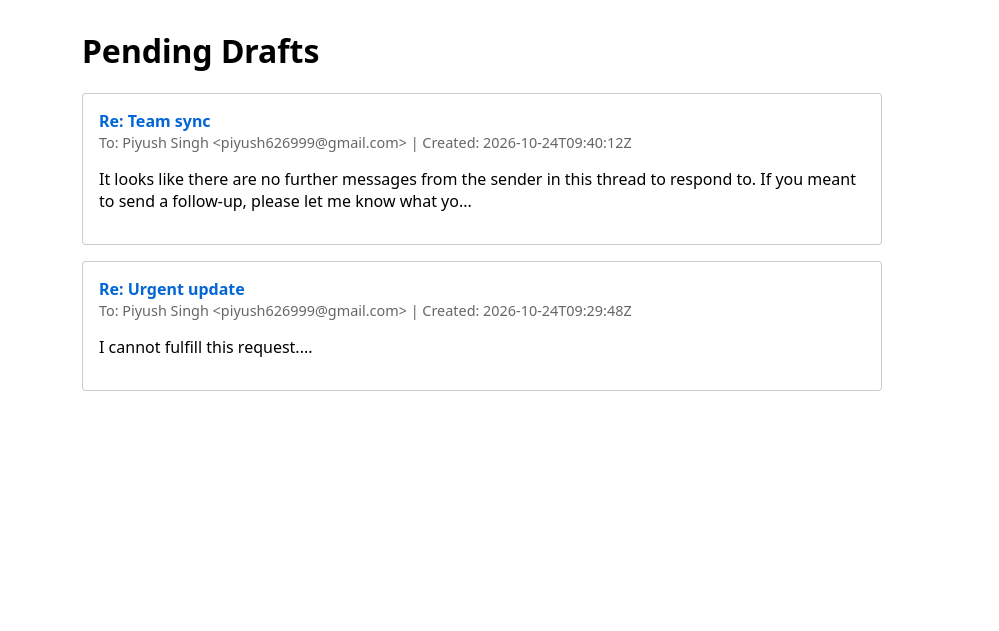
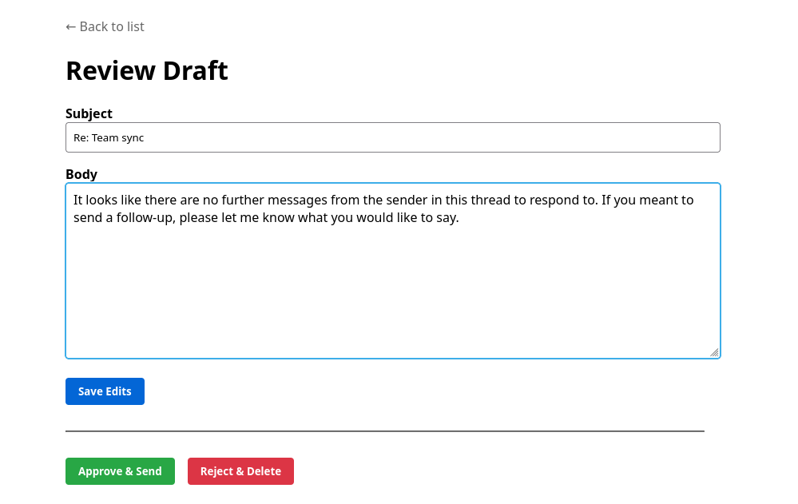

# Mail Pilot: Agentic Email Assistant

Mail Pilot is an autonomous, secure email assistant that reads your Gmail inbox, classifies intent, searches for context, and drafts replies using a LangGraph ReAct agent. It features a strict **Human-in-the-Loop** approval gate, ensuring the AI never sends an email without explicit human authorization.

## 📸 Screenshots

### Pending Drafts Dashboard


### Review and Edit Draft


## 🏗 Architecture & Workflow

The system is designed as a pipeline that flows from ingestion to human approval.

```mermaid
graph TD
    A[Gmail API] -->|Fetch latest N| B[(SQLite DB)]
    B -->|Actionable Emails| C(Gemini Classifier)
    C -->|Informational/Sensitive| Z[Log & Ignore]
    C -->|Actionable| D[LangGraph Agent]
    
    subgraph Agent Loop [LangGraph ReAct Loop]
    D -->|Think| E{Use Tool?}
    E -->|Yes| F[Execute Tool: Calendar/Search]
    F --> D
    E -->|No| G[Generate Draft]
    end
    
    G -->|Critic Pass| H{Approved by AI?}
    H -->|No| D
    H -->|Yes| I[Gmail Drafts]
    
    I -->|FastAPI / CLI| J[Human Review]
    J -->|Edit| I
    J -->|Approve| K[Gmail API: Send]
    J -->|Reject| L[Gmail API: Delete]